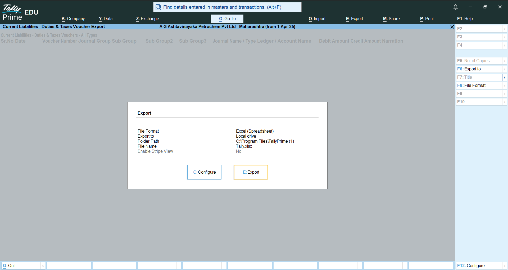

# Frontend User Manual — User Guide (Module by Module)

This guide is written for users (product owners, managers, and operators). It explains how to perform common tasks in each part of the application. No technical steps, no code — just what to do in plain language.
This version follows the application navigation order (the same order shown in the sidebar). Each section explains, in plain language, what users typically do there and how to do it.

1. Dashboard
- What you do: See a quick summary of sales, stock alerts, and outstanding items.
- How to: Open Dashboard for an at-a-glance view; click any widget to drill into details.

2. Data Import
- What you do: Import all your Tally data from one page, step by step — Products, Agencies, Purchases, Sales, Transactions, Debit/Credit Notes and Journals. Run every step in one go, or import only the ones you need.
- How to:
  1. Click Data Import in the left menu (just below Dashboard).
  2. On each step, click "Choose an .xlsx or .xls file" and pick the Tally export shown next to "File:". Transactions and Journals both read the Tally journal format — if one file holds both, attach it to one step and click "Use the same file" on the other.
  3. All steps are ticked. Untick the ones you don't want, or use Select all / Clear.
  4. Click Start Import. The ticked steps run one after another in this window, each with a progress bar and Imported / Failed / Skipped / Total counts. Run status on the right shows overall progress.
  5. To import one thing only, click "Import only this" on that step.
  6. If the server rejects a file, the run pauses on that step — click Retry, Skip and continue, or Stop.
  7. When a step finishes it shows Completed or Completed with failures. Click "Show failed rows" to see why rows failed. Failed Purchase, Sale, Transaction and Journal rows also download as an Excel error report.
  8. Cancel stops the run (rows already processed stay imported). Reset clears all files and results.

Steps and the file each one needs (Excel .xlsx / .xls, max 20 MB):

| Step | File to upload | What it creates |
|---|---|---|
| 1. Product Master | Tally Stock Summary | Products and opening stock |
| 2. Agencies | Tally Sundry Debtors / Sundry Creditors | Vendors and clients with opening balances (existing agencies are updated) |
| 3. Purchase Register | Tally Purchase Register | Purchase invoices |
| 4. Sale Register | Tally Sales Register | Sales invoices |
| 5. Transactions | Tally Journal Register / Day Book | Payment, receipt and invoice-linked vouchers only |
| 6. Debit / Credit Notes | Note register (Date, Particular, Voucher Type, Voucher No., Debit, Credit, Path) | Inward and outward notes linked to approved purchase / sale invoices; existing notes are skipped |
| 7. Journals | From the Trial Balance report in Tally, for each head export all the vouchers in the sample journal format | Journal vouchers only (invoice vouchers are skipped) |

Journals file from Tally
- From the Trial Balance report in Tally, for each head export all the vouchers in the sample journal format.
- In Tally: open the Trial Balance, open a head, press E: Export, set File Format to Excel (Spreadsheet), then click E: Export. Repeat for each head.
- The exported sheet has the columns Sr.No, Date, Voucher Number, Journal Group, Sub Group, Sub Group2, Sub Group3, Journal Name / Type, Ledger / Account Name, Debit Amount, Credit Amount and Narration.

Tips
- The first time, run the steps in order — purchases and sales need products and agencies; notes need approved purchase and sale invoices.
- Opening balances (Tally Trial Balance) are not on this page: import them from Journal → Journals tab → Import Opening Balances, after Agencies and before Purchases.
- Keep the window open until Run status shows "Run finished".
- The import buttons on the module pages (Import Products, Import Agencies, Import Purchase Register, etc.) still work as before.

3. Branch Management
- What you do: Add or update branch locations and contact info.
- How to: Open Branch Management, choose Add or Edit, enter branch details, then Save.

4. User Management
- What you do: Create and manage user accounts.
- How to: Open User Management, add a new user, assign a role and branch if needed, then Save.

5. Access Control
- What you do: Manage roles and permissions for users.
- How to: Open Access Control to view or update role definitions and assign them to users.

6. Agency Management
- What you do: Manage external partners or agencies and their commissions.
- How to: Open Agency Management, add agency details, assign customers or commissions, then Save.

7. Product Management
- What you do: Add, update, and review products and pricing.
- How to: Open Product Management, choose Add or Edit, follow the prompts to enter product information, then Save. Use product list to check stock and pricing.

Product details and descriptions
- Product description: Use this area to explain the product's key features (size, capacity, material, color, packaging). Write it as you would like customers and colleagues to read it on an invoice or product list — clear, concise, and with any special handling or storage notes.
- SKU / Code: Use a short code for quick search and identification. This helps sales and inventory staff find items fast.
- Category & Unit: Classify products so they appear in the right lists and reports. Choose the unit that matches how you count the item (piece, kg, litre).
- Price and Stock: Enter the usual selling price and maintain stock so reorder alerts work correctly.

8. Manufacturing
- What you do: Record manufacturing or production runs and manage finished goods.
- How to: Open Manufacturing, create a new production entry, list consumed items and produced items, then Confirm to update inventory.

9. Purchase & Sales
- What you do: Quick access to both purchase and sales flows (create orders and invoices).
- How to: Use Purchase & Sales as a starting point to create orders or invoices—follow the guided steps on screen and Save or Issue when done.

10. Purchase Order
- What you do: Create and manage purchase orders to suppliers.
- How to: Open Purchase Order, create a new order, add supplier and items, submit the order, and later confirm receipt when goods arrive.

11. Credit/Debit Notes
- What you do: Issue or record credit and debit notes related to invoices.
- How to: Open Credit/Debit Notes, link to the original invoice, specify reason, then Save and notify the counterparty.

12. Transactions
- What you do: View and create financial transactions (payments, receipts, adjustments).
- How to: Open Transactions to record a payment or receipt and link it to the appropriate invoice or supplier.

13. Inventory Management
- What you do: Receive stock, transfer items, and make adjustments.
- How to: Open Inventory Management, choose Receive, Transfer, or Adjust, follow prompts to record quantities and reasons, then Confirm.

14. Ledger
- What you do: Review financial and product-ledger records.
- How to: Open Ledger to view Product Ledger or Financial Ledger. Use filters and date ranges to narrow results.

15. Journal
- What you do: Create or review journal entries for accounting adjustments.
- How to: Open Journal to add manual entries or review past journal activity.
- Import journals: From the Trial Balance report in Tally, for each head export all the vouchers in the sample journal format (Export → File Format: Excel (Spreadsheet)). Then upload the file from Journal → Journals tab → Import Register, or from Data Import step 7 (see "Journals file from Tally" in section 2).

16. Reports
- What you do: Run business reports such as outstanding balances, day books, GST, inventory, and trial balance.
- How to: Open Reports, pick the report you need (AP/AR, Branch Day Book, GSTR-1, GST Suspense, GST Ledger, Inventory, Trial Balance), choose date range and filters, then Generate and Export.

17. Settings
- What you do: Update company-wide settings like company information, taxes, and invoice preferences.
- How to: Open Settings, update details, then Save. Changes will apply to future documents.

Settings — important fields and what they control
When editing Settings you will see labeled entries that control how the system behaves. Below are common names you will encounter and what they do:

- `Company Name` and `Address`: Appear on invoices, purchase orders, and official documents. Keep the legal company name here.
- `Tax ID` / `GSTIN`: Enter your tax identifier so invoices show correct tax registration details.
- `Invoice Number Format`: Controls how invoice numbers are generated (e.g., prefix, date, sequential number). Choose a format that matches your accounting practices.
- `Default Tax Rates`: Set the common tax percentages your products use so taxes are applied automatically on new documents.
- `Currency` and `Decimal Places`: Set the default currency and how many decimals to show on amounts.
- `Enable Inventory Tracking`: Turn on to make stock levels decrease when sales are issued and increase when goods are received.
- `Batch / Lot Tracking` and `Serial Numbering`: Enable if your products require batch numbers or serial tracking — useful for warranties or recalls.
- `Default Payment Terms`: Set default credit days (e.g., 30 days) to prefill new invoices and purchase orders.
- `Email Settings` (Sender Address): Configure the company email address used when sending invoices or notifications.
- `Rounding Preferences`: Control how totals are rounded on invoices (round per line, round final total, etc.).

Tip: When you change a setting, check a sample invoice or purchase order to confirm the change appears as expected.

General tips
- Double-check entries before saving.
- Attach supporting documents where available (invoices, challans, photos).
- Use the Dashboard and Reports to confirm outcomes after large operations.

Next steps
- I can produce printable one-page checklists for any of these modules. Tell me which modules to create first.
